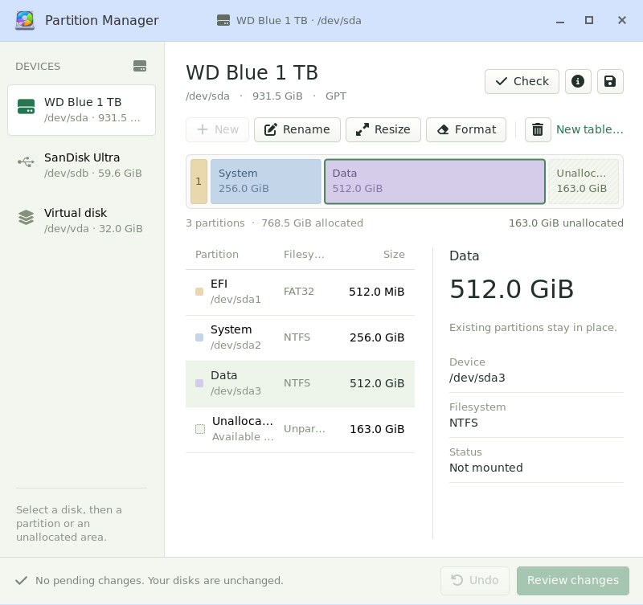

# Partition Manager

A native C/GTK3 partition manager for Linux.
It uses `sfdisk` for partition-table operations and the installed filesystem
utilities for formatting and growth. It does not link libparted or implement
an on-disk partition-table writer. The application has no Python, browser or
WebView dependency.

<a href="screenshots/partition-manager.png">
  
</a>

An example Windows disk layout with EFI, System and Data partitions.

## Build and run

On Debian 13, install `build-essential`, `pkg-config`, `libgtk-3-dev`,
`libjson-glib-dev` and `libudev-dev`, then run:

```sh
make
./build/partition-manager
sudo ./build/partition-manager
```

Without administrator privileges the application allows inspection and
planning, but disables applying changes. `--read-only` explicitly selects
this mode. `--device PATH` restricts the view to one device or regular disk
image; image files support partition-table operations, while filesystem
operations require a block device or a loop-backed image.
Loop devices are hidden unless `--include-loop` is passed, including with
`--device`. Compressed RAM (`zram`) devices are always hidden. An empty
inventory displays “No disks were found.” Slax's launcher uses the default
device filter.

`make install` installs the executable, desktop entry, icon and icon license.
`DESTDIR` and `PREFIX` are supported. Slax's desktop compile recipe builds
and packages Partition Manager in its disposable compilation branch, with runtime
library dependencies derived by `dpkg-shlibdeps`.

## Scope and interaction

- GPT and the four primary partitions of MBR tables.
- New partition tables default to GPT. Whole-device filesystems are shown without
  mistaking their boot sectors for an empty MBR table, including their mounts.
  **New** opens the table dialog when a device has no GPT/MBR table.
- The partition details pane is informational; actions stay in the toolbar.
- Create, delete, rename GPT partitions, create a new table and repair a
  flashed image's GPT to use the full device.
- Resize edits pending partitions from either edge and moves them within their
  free interval. For existing partitions, Resize only offers supported growth
  to the right; their start stays fixed. Rename remains a separate action.
- Coarse capacity labels, without manual sector or size inputs.
- Unallocated intervals are derived from occupied extents, including
  alignment padding. Adjacent free space always appears as one area.
- Per-device icons distinguish USB, ordinary disks, RAID and virtual devices.
- Undo changes to the plan, review the complete diff and explicitly apply it.
- Check the partition table and export the exact proposed sfdisk script.
- Double-click a map cell or row to create a partition in unallocated space,
  resize a partition, or rename it when resizing is unavailable. When GPT/MBR
  is absent, double-click opens the new partition table dialog.

Whole-device udev events update the sidebar without polling or reloading existing
layouts. Only newly connected devices are probed. Partition events are filtered
out in the kernel; work is queued until disk jobs and dialogs finish. Existing
rows and selection stay in place. Disconnected devices with pending changes or
Undo history remain in the plan until those edits are discarded; Apply still
verifies device identity and table contents before writing.

Dialog actions stay together at the right edge, with the primary action before
Cancel. Applying changes opens a modal progress bar showing device checks,
backup, table writing and verification, then each filesystem operation. Progress
counts completed phases rather than estimating elapsed time. The dialog cannot
cancel a write or be closed while the operation is running.

The GTK CSS and Cairo geometry implement the native window frame, allocation
map, aligned table columns, detail panel and draggable editor directly.
There is one Workspace rather than multiple design variants.
The window resizes in both directions. The device sidebar and detail pane
keep their widths while the disk map and table columns adapt, giving more
space to partition names than filesystem types. Short windows scroll the
device list, partition list and details with overlay scrollbars.

| Filesystem | Create | Grow |
|---|---|---|
| ext4 | `mkfs.ext4` | `resize2fs`; offline growth runs `e2fsck -f -p` first |
| XFS | `mkfs.xfs` | `xfs_growfs` |
| Btrfs | `mkfs.btrfs` | `btrfs filesystem resize`; single-device filesystems |
| NTFS | `mkfs.ntfs` | `ntfsresize`, subject to its mount/health requirements |
| FAT32 | `mkfs.fat` | Not offered |
| exFAT | `mkfs.exfat` | Not offered |

Filesystem adapters deliberately cover these basic operations. Tool presence
controls which adapters are offered. GPT/MBR type identifiers come from the
running `sfdisk --list-types --label …`; no GUID catalogue is embedded.
Inventory columns are discovered using `lsblk --list-columns --json`.
Signatures are probed directly with `blkid -p -o json` because udev's cached
information can be stale immediately after formatting. JSON preserves labels
containing spaces, backslashes and Unicode without export-format escaping.
Unmounted filesystem sizes come
from `tune2fs`, `xfs_db`, `btrfs inspect-internal` and `ntfsinfo`.

The command protocols target util-linux 2.41 or newer and the tools supplied
by Debian 13. The small adapter set is intentional: command availability is
not treated as a machine-readable description of every possible operation.

## Applying changes and in-use disks

Changes are held in memory until review. Each opening of Review reads current
usage and checks that the device and partition table still match the plan.
If a disk is mounted, used as swap,
or has active device-mapper/RAID users, review shows a specific warning and
requires an acknowledgement. The user may then change its table, including
deleting mounted partition entries. The application does not automatically
unmount filesystems or deactivate mappings. Affecting a mounted filesystem
can corrupt its data or stop the running system.

Review offers **Unmount partitions** for mounted filesystems. This explicit
action opens partitions read-only, avoiding write-close notifications that
trigger automounters. It uses ordinary unmounts, including bind mounts of the same filesystem;
it never forces or lazily detaches a busy mount, disables swap, or deactivates
mappings. A new usage check shows a green ready confirmation only when no
active uses remain. Otherwise the warning and acknowledgement remain. Pending
edits are preserved, and applying still rechecks usage immediately before writes.

For an acknowledged in-use disk, sfdisk receives `--no-reread` and
`--no-tell-kernel`. Individual entries are updated with `partx`, leaving
unrelated mounted partitions alone. If the kernel refuses a change, the
on-disk table is retained and the application reports that a restart is
required. A filesystem command is never redirected to a partition whose
kernel boundaries differ from the intended extent.

NTFS growth first runs a read-only readiness check on the original partition.
A mounted or unhealthy NTFS volume is rejected before its partition is enlarged.
Online ext growth skips offline e2fsck. XFS and Btrfs use their existing
verified mount point, or a temporary mount if initially unmounted. Native
filesystem tools can reject an operation they cannot perform. Explicitly
acknowledged formatting of an in-use ext filesystem uses mke2fs's two-force
mode; other formatters retain their native rules. Shrinking existing
filesystems and moving existing data are outside the supported scope.

Before writing, the backend pins the selected device with a file descriptor,
checks its identity and capacity, locks it, and compares its current table
and hardware identity with the original plan. Changed or replaced devices
invalidate the plan. Commands receive the pinned descriptor rather than
reopening a potentially reassigned disk name. Partition descriptors must
match the parent disk, kernel start and size, and original filesystem UUID.

Table backups are saved in `$XDG_STATE_HOME/partition-manager/backups` (normally
`~/.local/state/partition-manager/backups`). They preserve metadata, not file data.
Creating a new table removes obsolete whole-device filesystem, RAID and encryption
signatures with `wipefs`, saving their signature backups alongside the table backup.
Ordinary table edits preserve signatures, and table boot code is retained.
The generated script is checked with `sfdisk --no-act`; the written table is
then reread and checked before formatting or growth. Existing table IDs,
partition UUIDs, GPT attributes and MBR boot flags are preserved. Failures
stop subsequent operations and reload the real layout. Completed changes
are retained; Undo never pretends to roll back writes to a disk.

## Verification

```sh
make check
sudo sh test-integration
sudo sh test-ui
```

`make check` exercises the model and actual GPT/MBR writes and GPT repair on
temporary sparse files. The integration script creates a private 2 GiB file
and loop device under `/tmp`, tests all six formatters and four growers,
checks preserved ext4 data, locks and stale-plan rejection, and exercises
acknowledged changes with a mounted source partition. The GUI test uses its
own loop fixture and Xvfb; it verifies selection, both resize edges, movement,
Resize, Undo and context-sensitive map/row double-clicks without applying its plan.
GUI screenshots are written under `/tmp/partitions-native-*.png`.

Loop tests require root, the listed filesystem tools, `losetup`, and, for
the GUI test, `xvfb-run` and `xauth`. They never target physical disks.

## Artwork and references

Selected unmodified SVGs are from Font Awesome Free 6.7.2 by Fonticons, Inc.,
licensed under [CC BY 4.0](https://creativecommons.org/licenses/by/4.0/).
See [the upstream license](icons/LICENSE.txt). The application mark matches
Slax's Partition Manager launcher artwork. The application is distributed
under the GNU GPL; see [LICENSE](LICENSE).
All artwork is bundled and no CDN is needed at runtime.

Command references:
[sfdisk](https://man7.org/linux/man-pages/man8/sfdisk.8.html),
[lsblk](https://man7.org/linux/man-pages/man8/lsblk.8.html),
[resize2fs](https://man7.org/linux/man-pages/man8/resize2fs.8.html),
[xfs_growfs](https://man7.org/linux/man-pages/man8/xfs_growfs.8.html),
[Btrfs](https://btrfs.readthedocs.io/en/latest/btrfs-filesystem.html),
[ntfsresize](https://github.com/tuxera/ntfs-3g/blob/edge/ntfsprogs/ntfsresize.8.in).
